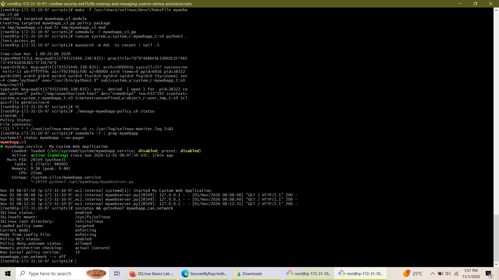
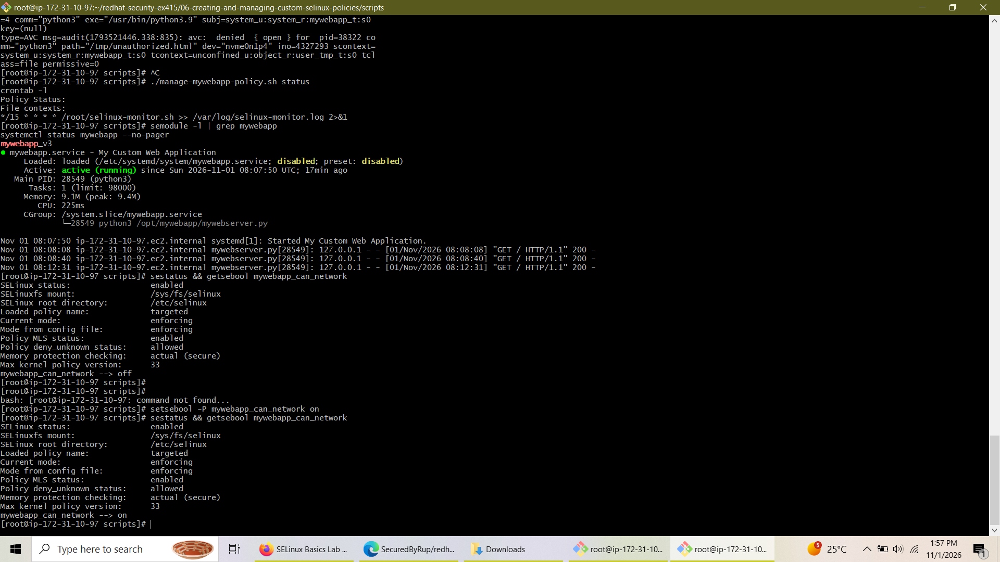

# Lab 6: Creating and Managing Custom SELinux Policies

---

## 📋 Project Overview
This repository contains the full source code, SELinux policy definition modules, automated maintenance shell scripts, and verification artifacts for **Lab 6: Creating and Managing Custom SELinux Policies** under the RHEL Security hardening curriculum (`EX415`).

The project demonstrates end-to-end security policy engineering: confining a custom web application daemon (`mywebserver.py`) under a dedicated SELinux domain (`mywebapp_t`), enforcing mandatory access controls (MAC) over file access and execution entrypoints, implementing conditional runtime booleans, and establishing automated policy compliance monitoring.

---

## 🏗️ Architecture & Component Specifications

* **Target Domain:** `mywebapp_t` (confined process context for web server execution)
* **File Types & Context Assignments:**
  * **Executable Entrypoint:** `mywebapp_exec_t` (`/opt/mywebapp/mywebserver.py`)
  * **Application Content:** `mywebapp_content_t` (`/opt/mywebapp/content/`)
* **Service Environment:** Managed via `systemd` (`mywebapp.service`) running under unprivileged user account `mywebapp` (UID `982`, GID `981`).
* **Runtime Policy Booleans:** `mywebapp_can_network` (persistent toggle for outbound network operations).
* **Automation Tools:**
  * `manage-mywebapp-policy.sh`: Operational script for status checking, backups, and module management.
  * `selinux-monitor.sh`: Automated AVC audit log inspection scheduled via cron (`*/15 * * * *`).

---

## ⚙️ Key Implementation Phases

1. **Policy Development (`v1` to `v3` Evolution):**
   * Drafted Type Enforcement (`.te`) and File Context (`.fc`) policy rules.
   * Resolved module re-declarations and enabled `corecmd_shell_entry_type(mywebapp_t)` to permit interpreter entry execution under `runcon`.
2. **Boundary Enforcement & Security Isolation:**
   * Configured the policy to permit reading web documents inside `/opt/mywebapp/content/`.
   * Enforced confinement to strictly deny unauthorized file reads outside the domain (e.g., `/tmp/unauthorized.html`).
3. **Audit Log & AVC Denial Analysis:**
   * Inspected Linux Audit System AVC logs via `ausearch` to verify real-time enforcement (`denied { open }`, `denied { entrypoint }`).
4. **Persistent Policy Hardening:**
   * Persistently enabled conditional network capability (`setsebool -P mywebapp_can_network on`).
   * Validated system-wide enforcing mode using `sestatus`.

---

## 📷 Verification Evidence & Screenshots

For optimal portfolio presentation, save the attached screenshot files inside an `assets/` folder in your repository using the following names:

* **File 1:** `Screenshot (781).png` $\rightarrow$ **`assets/01-selinux-policy-compilation-and-audit.png`**
* **File 2:** `Screenshot (782).png` $\rightarrow$ **`assets/02-selinux-boolean-enforcement.png`**

### Phase 1: Policy Compilation, AVC Audit Log, and Service Health
This capture verifies the compilation of `mywebapp_v3.pp`, kernel AVC denial log analysis (`ausearch`), cron job automation (`crontab -l`), active policy management execution (`./manage-mywebapp-policy.sh status`), and live web service health (`systemctl status mywebapp` returning `active (running)`).

### Phase 2: Persistent Boolean Activation & Global Enforcing Status
This capture validates the persistent enablement of the network tunable (`setsebool -P mywebapp_can_network on`) and confirms system-wide targeted SELinux enforcing status via `sestatus`.

---

## 🎯 Conclusion
This lab successfully demonstrates the implementation of enterprise-level Mandatory Access Controls (MAC) on Red Hat Enterprise Linux. By crafting custom policy domains, debugging entrypoint rules, auditing kernel AVC denials, and managing persistent booleans, the application environment achieves complete defense-in-depth security according to least-privilege principles.
