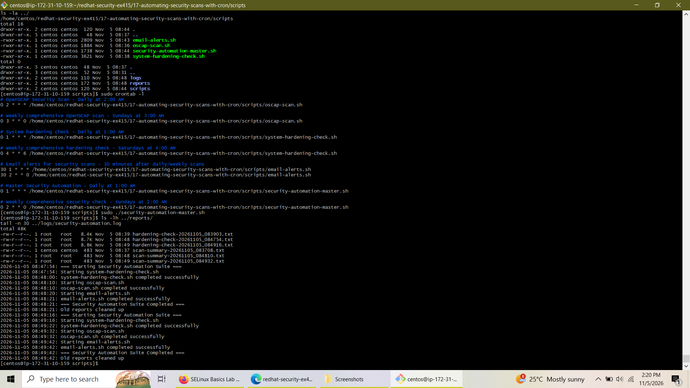
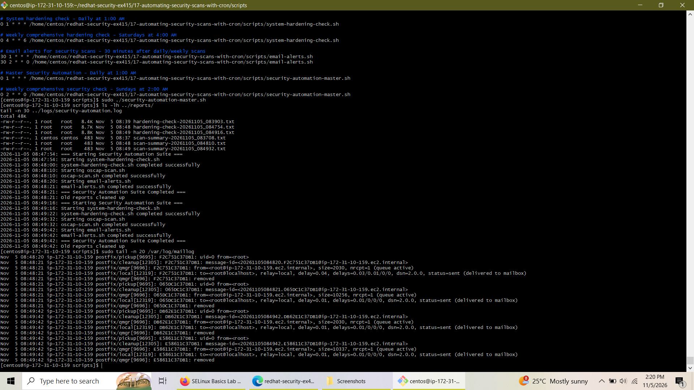

# Lab 17: Automating Security Scans with cron & OpenSCAP

<p align="left">
  
  
  
  
  
  
</p>

## 📌 Overview
This lab demonstrates the implementation of an automated enterprise security auditing and compliance framework on **Red Hat / CentOS Stream 9**. By combining **OpenSCAP** compliance scanning, custom **system hardening checks**, intelligent threshold-based **email alerting** via **Postfix / s-nail**, and **Cron** scheduling, this project establishes a fully autonomous security pipeline. 

To maintain clean portfolio version control, all configuration files, executable scripts, runtime logs, and audit reports are structured locally within the repository directory.

---

## 📂 Project Architecture & Directory Structure
```text
redhat-security-ex415/
└── 17-automating-security-scans-with-cron/
    ├── scripts/
    │   ├── oscap-scan.sh
    │   ├── system-hardening-check.sh
    │   ├── email-alerts.sh
    │   └── security-automation-master.sh
    ├── logs/
    │   ├── oscap-scan.log
    │   ├── hardening-check.log
    │   ├── email-alerts.log
    │   └── security-automation.log
    └── reports/
        ├── oscap-results-*.xml
        ├── oscap-report-*.html
        ├── scan-summary-*.txt
        └── hardening-check-*.txt
```

---

## 🛠️ Implementation Details

### 1. OpenSCAP Automated Scanning (`oscap-scan.sh`)
* Leverages `openscap-scanner` and `scap-security-guide` against the CIS benchmark profile (`xccdf_org.ssgproject.content_profile_cis`).
* Automatically generates human-readable HTML audit reports, machine-parseable XML result files, and text summaries saved directly to `../reports/`.

### 2. System Hardening Checks (`system-hardening-check.sh`)
* Audits critical security postures including password aging policies (`/etc/login.defs`), SSH configuration compliance (`sshd_config`), firewall status (`firewalld`), failed login attempts (`lastb`), world-writable files, SUID/SGID binaries, and active network connections.

### 3. Intelligent Alerting & Postfix Integration (`email-alerts.sh`)
* Integrates `s-nail` and `postfix` to parse recent local report summaries.
* Automatically dispatches critical email alerts with report attachments to `root@localhost` if scan failures or rule violation thresholds are breached.

### 4. Master Orchestration (`security-automation-master.sh`)
* Coordinates the sequential execution of hardening checks, compliance scans, and alert evaluations with robust logging, error handling, and a 30-day log/report retention cleanup policy.

---

## ⏱️ Cron Automation Schedule
The root crontab manages the execution schedule:
```cron
# Master Security Automation - Daily at 1:00 AM
0 1 * * * /home/centos/redhat-security-ex415/17-automating-security-scans-with-cron/scripts/security-automation-master.sh

# Weekly comprehensive security check - Sundays at 2:00 AM
0 2 * * 0 /home/centos/redhat-security-ex415/17-automating-security-scans-with-cron/scripts/security-automation-master.sh
```

---

## 📸 Verification & Screenshots

### Script Permissions, Crontab Setup, and Master Execution Log
*File: `images/automation-execution-and-crontab.png`*
> Displays local executable script permissions, active root crontab jobs, manual execution of the master security suite, and generated audit report files.


### Postfix Mail Delivery Verification
*File: `images/postfix-mail-delivery-verification.png`*
> Demonstrates successful mail queue processing and local delivery (`status=sent (delivered to mailbox)`) captured via `/var/log/maillog`.


---

## 🎯 Conclusion
Lab 17 successfully establishes a robust, automated security posture management system on Enterprise Linux. By encapsulating OpenSCAP scans, hardening validations, and email notifications into an orchestrated pipeline managed by Cron and version-controlled locally, administrative overhead is minimized while continuous compliance and rapid incident detection are guaranteed.